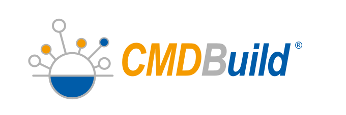

# CMDBuild



[](COPYING)

CMDBuild is an open source platform for managing digital and physical
assets, services, infrastructures and business processes. Organizations
can build custom data models to represent their assets and their
relationships, creating a centralized repository of information that
supports operational activities, governance and decision-making.

The platform includes workflow automation, document management, reporting,
dashboards, GIS capabilities and integration services. CMDBuild can be
used as a Configuration Management Database (CMDB), an enterprise asset
management solution, a service management platform or a repository for
technical and organizational information, adapting to different business
and public sector requirements through extensive configuration features.

CMDBuild provides interoperability capabilities through REST APIs, web
services, connectors and integration tools, enabling data exchange and
process orchestration with external applications, enterprise systems and
third-party platforms.

* **CMDBuild** - The platform for Asset Management - https://www.cmdbuild.org
* **CMDBuild READY2USE** - IT Assets & Services Management - https://www.cmdbuildready2use.org
* **openMAINT** - Property & Facility Management - https://www.openmaint.org

Maintainer: PAT S.r.l. – https://www.pat.eu

Copyright PAT S.r.l. 2005-2026 · SPDX-License-Identifier: AGPL-3.0-only

## Contents

* [Quick start](#quick-start)
* [Requirements](#requirements)
* [Deployment](#deployment)
* [Documentation](#documentation)
* [Languages](#languages)
* [Contributing](#contributing)
* [Security](#security)
* [License](#license)
* [Copyright and ownership](#copyright-and-ownership)
* [Legal notices](#legal-notices)
* [Trademarks](#trademarks)
* [Third-party components](#third-party-components)

## Quick start

1. Install Java 25, Apache Tomcat 11 and PostgreSQL 17 (see [Requirements](#requirements)).
2. Download the release package and run the guided setup:

   ```sh
   java -jar cmdbuild.war
   ```

   Use `ready2use.war` for CMDBuild READY2USE and `openmaint.war` for openMAINT.
3. Follow the wizard: it configures the database and loads the dump you choose.

See [Deployment](#deployment) for a manual installation inside Tomcat.

## Requirements

### Hardware

| | Minimum (simple use cases) | Recommended (separate instances for all services) |
|---|---|---|
| CPU | server-class computer (modern architecture), 4-core | 8-core for each instance |
| RAM | 24 GB | CMDBuild application server: 16 GB<br>PostgreSQL database: 16 GB |
| Disk | 150 GB (application + database on the same server) | CMDBuild application server: 50 GB SSD<br>PostgreSQL database: 500 GB SSD |

For all other services, follow their recommended requirements.

### Software

| Component | Version | Notes |
|---|---|---|
| Operating system | any OS able to handle the following applications | Linux recommended |
| PostgreSQL | 17.11 | latest minor version recommended |
| PostGIS | 3.6.4 | optional |
| Apache Tomcat | 11.0.26 | other 11.x.x versions are expected to work |
| Java | 25 | OpenJDK or Amazon Corretto 25 recommended |
| Alfresco Community | Alfresco 26.2.0 | optional |
| GeoServer | 2.28.5 | optional |

### Included libraries

* jdbc library for DB connection
* jasperreports libraries for report generation
* Ext JS libraries for user interface
* Server and client components for map making feature
* Server and client components for BIM viewer (xeokit)

### Additional software that you may find useful (not included)

* JasperSoft Studio for custom report design
* Together Workflow Editor for custom workflow design

## Deployment

Before deployment make sure you have satisfied all the requirements above (especially
the postgres database and java environment).

CMDBuild can be deployed inside tomcat as any regular war-packaged webapp.

**Database configuration**: it is recommended to create a configuration directory under `<tomcat>/conf/<webapp_name>`
(the name of config directory must match the name of webapp deployment).
You will find an example of db configuration inside `<webapp>/WEB-INF/conf/database.conf_example`.
You must copy this to `database.conf` (either in config dir `<tomcat>/conf/<webapp_name>` or `<webapp>/WEB-INF/conf/`) and
edit it according to your database params.

A supported database has to be loaded before running the application, in the downloaded files there are different database
dumps you can use:

* `empty.dump.xz`: a database dump with a basic structure and some minimal information like a default admin account;
* `demo.dump.xz`: a database dump with a basic structure and some more information added in the system, like example users.

**Guided setup**: if you want to perform a clean installation you may use the graphic wizard (either run the `cmdbuild.sh`
installer or run `java -jar cmdbuild.war` directly from the war). By following the guided setup the database dump will be
automatically loaded based on the dump you choose in the configuration phase.
Use `ready2use.sh` or `ready2use.war` for CMDBuild READY2USE and `openmaint.sh` or `openmaint.war` for openMAINT.

## Documentation

* [Technical Manual](https://docs.cmdbuild.org/docs/technical/system-configuration)
* [CMDBuild documentation](https://docs.cmdbuild.org/)
* [Changelog](CHANGELOG.md)

## Languages

Available languages for CMDBuild project (first level localization):

English, Arabic, Brazilian Portuguese, Bulgarian, Chinese, Croatian, Czech, Danish,
Dutch, European Portuguese, French, German, Greek, Hungarian, Indonesian, Italian,
Japanese, Korean, Malay, Mongolian, Norwegian, Persian, Polish, Romanian, Russian,
Serbian (Latin), Serbian (Cyrillic), Slovak, Slovenian, Spanish, Thai, Turkish,
Ukrainian, Vietnamese.

For updated information please refer to https://www.cmdbuild.org/en/download/available-languages

Available languages for CMDBuild READY2USE (second level localization):
please refer to https://www.cmdbuildready2use.org/en/download/available-languages

Available languages for openMAINT (second level localization):
please refer to https://www.openmaint.org/en/download/available-languages

### External contributors

* Arabic translation by Mohammed Nabigh and Fahad Senan
* Brazilian Portuguese translation by T4HD
* Bulgarian translation by Yasen Arsov
* Chinese translation by Liansheng Yang
* Croatian translation by Tomislav Perić
* Czech translation by Igor Kurty
* Danish translation by Ali Araghi
* Dutch translation by Eric van Rheenen and Jeroen Baten
* European Portuguese translation by João Cruz and T4HD
* French translation by Damien Boustany-Kasper and Pierre Danel
* German translation by Susanne Tober
* Greek translation by Vasilis Papadakis and Dimitris Maniadakis
* Hungarian translation by Márton Natkó
* Indonesian translation by Inovamap
* Japanese translation by Satoru Funai
* Korean translation by Kyungik An
* Malay translation by Openstack Sdn Bhd
* Mongolian translation by Tsolmonbaatar Adiyasuren
* Norwegian translation by Lars Tangen
* Persian translation by Mohsen Salami
* Polish translation by Mike Gleczman and Sebastian Hajdus
* Romanian translation by Adrian Popescu
* Russian translation by Yasen Arsov
* Serbian (Latin and Cyrillic script) translation by Miroslav Zaric
* Slovak translation by Igor Kurty
* Slovenian translation by Tine Cus
* Thai translation by Wangkanai
* Turkish translation by Onur Guleryuz
* Ukrainian translation by Artem Yanchuk
* Vietnamese translation by Avenue JSC

## Contributing

Contributions are welcome: read [CONTRIBUTING.md](CONTRIBUTING.md) and the
[Code of Conduct](CODE_OF_CONDUCT.md).

## Security

Do not open public issues for vulnerabilities: follow [SECURITY.md](SECURITY.md).

## License

This program is free software: you can redistribute it and/or modify
it under the terms of the GNU Affero General Public License version 3
as published by the Free Software Foundation.

This program is distributed in the hope that it will be useful,
but WITHOUT ANY WARRANTY; without even the implied warranty of
MERCHANTABILITY or FITNESS FOR A PARTICULAR PURPOSE.
See the GNU Affero General Public License for more details.

You should have received a copy of the GNU Affero General Public License
along with this program ([COPYING](COPYING)).
If not, see <https://www.gnu.org/licenses/agpl-3.0.html>.

## Copyright and ownership

Title, copyrights, intellectual property rights, international treaty,
other rights as applicable and all other legal rights in the Software
and Documentation are and shall remain the sole and exclusive property
of PAT S.r.l. or its suppliers.
As well all modifications, enhancements, derivatives and other
alterations of the Software and Documentation regardless of who made
any modifications, if any, are and shall remain the sole and exclusive
property of PAT S.r.l. or its suppliers.
The license for use granted herein is limited to the Software and
Documentation and does not transfer any ownership rights from PAT S.r.l.
to End Users or any other intellectual property rights.

## Legal notices

The interactive user interfaces in modified source and object code
versions of this program must display Appropriate Legal Notices, as
required under Section 5 of the GNU Affero General Public License version 3.

## Trademarks

CMDBuild, CMDBuild READY2USE, openMAINT trademarks can't be altered
(colors, font, shape, etc) and can't be included in other trademarks.
CMDBuild, CMDBuild READY2USE, openMAINT trademarks can't be used as
a company logo, moreover no company can act as CMDBuild or
CMDBuild READY2USE or openMAINT author/owner/maintainer.
CMDBuild, CMDBuild READY2USE, openMAINT trademarks can't be removed
from the parts of the application in which they appear, and in
particular from the header at the top of each page.

In accordance with Section 7(b) of the GNU Affero General Public
License version 3, these Appropriate Legal Notices must retain the display
of the "CMDBuild", "CMDBuild READY2USE" or "openMAINT" logo.

The Logo "CMDBuild" must be a clickable link that leads directly
to the Internet URL https://www.cmdbuild.org

The Logo "CMDBuild READY2USE" must be a clickable link that leads directly
to the Internet URL https://www.cmdbuildready2use.org

The Logo "openMAINT" must be a clickable link that leads directly
to the Internet URL https://www.openmaint.org

For the trademark usage policy see [TRADEMARKS.md](TRADEMARKS.md).

## Third-party components

The CMDBuild source code is licensed under the GNU Affero General Public License
version 3 (see [License](#license)). Third-party components keep their own licenses.

* Sencha Ext JS 7.0.0 (user interface framework) is licensed under the
  GNU General Public License version 3. It is not part of this repository: the
  build downloads the GPL distribution of the SDK and the resulting user interface
  contains it. Ext JS remains under GPL v3 and is not relicensed.
  The combination with the AGPL v3 code is permitted by section 13 of both
  GPL v3 and AGPL v3.
* Sencha Cmd 7.6.0.87 is a build tool, it is not distributed with this software and
  it is subject to its own Sencha license.

Users who interact with a modified version through a network can obtain the
Corresponding Source, including the Ext JS code embedded in the combined work,
as required by section 13 of the AGPL v3.

Below is a list of the publicly available software and resources used
by and distributed with CMDBuild, along with the licensing terms.

| Component | License |
|---|---|
| [Ace](https://ace.c9.io) (Ajax.org Cloud9 Editor) | [BSD 3-Clause](https://raw.githubusercontent.com/ajaxorg/ace/master/LICENSE) |
| [Cytoscape.js](https://js.cytoscape.org) | [MIT](https://github.com/cytoscape/cytoscape.js/blob/master/LICENSE) |
| [D3](https://d3js.org) | [ISC](https://github.com/d3/d3/blob/main/LICENSE) |
| [FullCalendar](https://fullcalendar.io) | [MIT](https://github.com/fullcalendar/fullcalendar/blob/master/LICENSE.txt) |
| [html2canvas](https://html2canvas.hertzen.com) | [MIT](https://github.com/niklasvh/html2canvas/blob/master/LICENSE) |
| [jsPDF](https://github.com/parallax/jsPDF) | [MIT](https://github.com/parallax/jsPDF/blob/master/LICENSE) |
| [node-qrcode](https://github.com/soldair/node-qrcode) | [MIT](https://github.com/soldair/node-qrcode/blob/master/license) |
| [OpenLayers](https://openlayers.org) | [BSD 2-Clause](https://github.com/openlayers/openlayers/blob/main/LICENSE.md) |
| [sanitize-html](https://github.com/apostrophecms/sanitize-html) | [MIT](https://github.com/apostrophecms/sanitize-html/blob/main/LICENSE) |
| [Showdown](https://showdownjs.com) | [MIT](https://github.com/showdownjs/showdown/blob/master/LICENSE) |
| [three.js](https://threejs.org) | [MIT](https://github.com/mrdoob/three.js/blob/dev/LICENSE) |
| [xeokit SDK](https://xeokit.io) | [AGPL-3.0](https://github.com/xeokit/xeokit-sdk/blob/master/LICENSE.txt) (also available under a commercial license) |

The Java libraries included in the war keep their own licenses: the license
and notice files of each library are distributed inside its jar
(`WEB-INF/lib/*.jar`, under `META-INF`).
